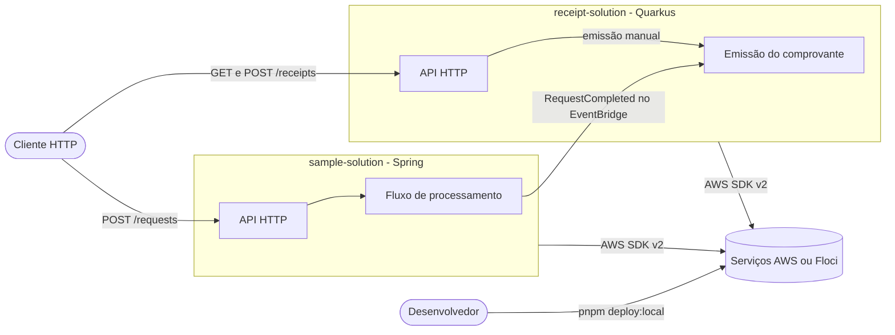
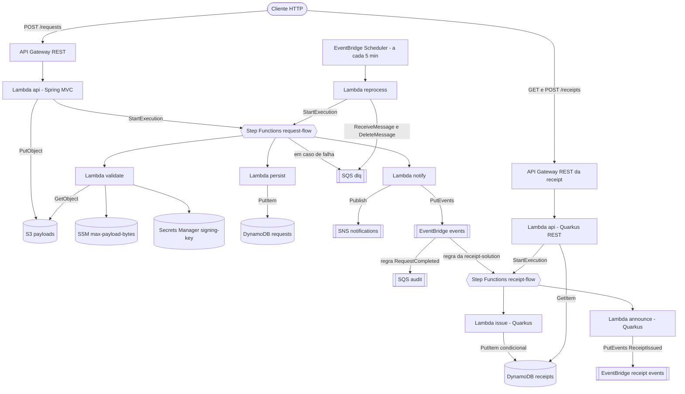
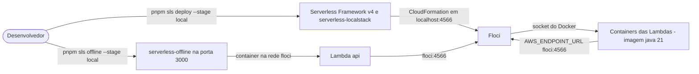

# Arquitetura

O ambiente serve para projetar soluções serverless orquestradas pelo AWS Step Functions, com
Lambdas em Java 21 escritas em Spring Boot 4.0 ou Quarkus 3.40 (LTS), conforme o propósito de cada
solução. O deploy usa o Serverless Framework v4 e, localmente, o
[Floci](https://github.com/floci-io/floci) emula os serviços da AWS na porta 4566.

A `sample-solution`, em Spring, é a solução de referência: recebe uma requisição HTTP, valida,
persiste e notifica, com falhas enviadas para uma fila de mensagens com falha (DLQ) e reprocessamento
agendado. A `receipt-solution`, em Quarkus, reage ao `RequestCompleted` da sample e emite um
comprovante para cada pedido concluído. As duas compartilham o ambiente AWS e só se conhecem pelo
evento ([ADR 0011](decisions/0011-integracao-entre-solucoes-por-eventbridge.md)). O passo a passo de
cada caminho está em [Fluxos](flows.md).

## Contexto



## Containers



As Lambdas `api`, `validate`, `persist`, `notify` e `reprocess` da parte de cima são da
`sample-solution`, em Spring. A `api`, o `issue` e o `announce` da `receipt-solution` são em Quarkus.

## Módulos Maven

| Módulo | Empacotamento | Responsabilidade |
|---|---|---|
| `serverless-parent` (raiz) | `pom` | Neutro: Java 21, versões e configuração dos plugins Maven e `testcontainers-floci` ([ADR 0010](decisions/0010-raiz-neutra-e-parents-por-framework.md)) |
| `platform/spring-parent` | `pom` | Importa os BOMs do Spring Boot 4.0.9, do AWS SDK 2.57.12 e do Spring Cloud 2025.1.4; exclui `apache-client` e `netty-nio-client` de cada service do SDK; define o empacotamento em zip para Lambda, herdado pelo módulo que declarar `maven-dependency-plugin` e `maven-assembly-plugin` |
| `platform/quarkus-parent` | `pom` | Importa os BOMs do Quarkus 3.40.1.2 e do Quarkus Amazon Services (AWS SDK 2.54.13) e configura o `quarkus-maven-plugin` |
| `platform/spring-aws` | `jar` | Só para soluções Spring: autoconfiguração dos clients síncronos do SDK, cada um com o próprio `AwsCrtHttpClient` e criado só quando o SDK correspondente está no classpath ([ADR 0005](decisions/0005-clients-sincronos-com-crt.md)) |
| `sample-solution` | `pom` | Herda do `spring-parent`; agrega `api` e `functions` e, com `-Pe2e`, o `e2e` |
| `sample-solution/api` | `jar` + zip | Lambda HTTP com Spring MVC via `aws-serverless-java-container-springboot4` |
| `sample-solution/functions` | `jar` + zip | Lambdas dos passos e do reprocessamento com Spring Cloud Function |
| `sample-solution/e2e` | `jar`, só com testes | Testes ponta a ponta contra a stack implantada; entra no build apenas com o perfil `-Pe2e` ([Testes](testing.md)) |
| `receipt-solution` | `pom` | Herda do `quarkus-parent`; agrega `functions` e, com `-Pe2e`, o `e2e` |
| `receipt-solution/api` (`receipt-api`) | `jar` + `receipt-api-lambda.zip` | Lambda HTTP com Quarkus REST via `quarkus-amazon-lambda-rest`: consulta e emissão manual de comprovantes |
| `receipt-solution/functions` (`receipt-functions`) | `jar` + `receipt-functions-lambda.zip` | Lambdas `issue` e `announce` com `quarkus-amazon-lambda`; clients do Quarkus Amazon Services com `aws-crt` |
| `receipt-solution/e2e` (`receipt-e2e`) | `jar`, só com testes | Teste ponta a ponta entre as duas soluções; exige as duas stacks implantadas |

## Lambdas

| Função | Handler | Gatilho | SDKs usados | Entrada e saída |
|---|---|---|---|---|
| `api` | `com.mmda.serverless.sample.api.StreamLambdaHandler::handleRequest` | API Gateway, `POST /requests` | S3, Step Functions | Evento proxy do API Gateway; responde `202` ([OpenAPI](api/openapi.yaml)) |
| `validate` | `org.springframework.cloud.function.adapter.aws.FunctionInvoker::handleRequest` | Step Functions | S3, SSM, Secrets Manager | `RequestContext` → `RequestContext` com `signature` e `payloadBytes` |
| `persist` | `FunctionInvoker` | Step Functions | DynamoDB | `RequestContext` → `RequestContext` |
| `notify` | `FunctionInvoker` | Step Functions | SNS, EventBridge | `RequestContext` → `RequestContext` |
| `reprocess` | `FunctionInvoker` | EventBridge Scheduler, `rate(5 minutes)` | SQS, Step Functions | `ReprocessCommand` → `ReprocessResult` |

As quatro funções do módulo `functions` usam o mesmo zip. Cada Lambda escolhe a sua pela variável
`SPRING_CLOUD_FUNCTION_DEFINITION`, e o `FunctionInvoker` encontra a aplicação pela variável
`MAIN_CLASS`. Os formatos de `RequestContext`, `ReprocessCommand` e `ReprocessResult` estão no
[AsyncAPI](events/asyncapi.yaml).

Lambdas da `receipt-solution`, em Quarkus:

| Função | Handler | Gatilho | SDKs usados | Entrada e saída |
|---|---|---|---|---|
| `api` | `io.quarkus.amazon.lambda.runtime.QuarkusStreamHandler::handleRequest` | API Gateway, `GET /receipts/{requestId}` e `POST /receipts` | DynamoDB, Step Functions | Evento proxy do API Gateway; responde `200`/`404` e `202` ([OpenAPI](api/receipt-solution.openapi.yaml)) |
| `issue` | `QuarkusStreamHandler` | Step Functions `receipt-flow`, com `InputPath: $.detail` | DynamoDB | `CompletedRequest` → `Receipt` |
| `announce` | `QuarkusStreamHandler` | Step Functions `receipt-flow` | EventBridge | `Receipt` → `Receipt` |

A Lambda `api` usa o `QuarkusStreamHandler` da extensão `quarkus-amazon-lambda-rest`, que converte o
evento do API Gateway REST numa requisição para o Quarkus REST (`ReceiptResource`): `GET
/receipts/{requestId}` lê a tabela e `POST /receipts` inicia o `receipt-flow` com
`{"detail": <corpo>}`, o mesmo formato do evento ([OpenAPI](api/receipt-solution.openapi.yaml)).

`issue` e `announce` usam o mesmo `receipt-functions-lambda.zip`. Cada Lambda escolhe o seu handler pela variável
`QUARKUS_LAMBDA_HANDLER`, que bate com o `@Named` de `IssueReceiptHandler` e `AnnounceReceiptHandler`.
O formato do `Receipt` está no [AsyncAPI da receipt-solution](events/receipt-solution.asyncapi.yaml).

## Recursos AWS

Declarados em `sample-solution/serverless.yml`. Os nomes seguem o padrão
`sample-solution-<stage>-<sufixo>`; no stage `local`, `sample-solution-local-payloads` e assim por diante.

| Recurso lógico | Tipo | Sufixo do nome | Uso |
|---|---|---|---|
| `PayloadBucket` | `AWS::S3::Bucket` | `payloads` | Payload original de cada requisição, em `requests/<requestId>.json` |
| `RequestsTable` | `AWS::DynamoDB::Table` | `requests` | Resultado da validação; chave `requestId` (texto), cobrança por requisição |
| `RequestFlowStateMachine` | `AWS::StepFunctions::StateMachine` | `request-flow` | Orquestra `validate`, `persist` e `notify` |
| `DeadLetterQueue` | `AWS::SQS::Queue` | `dlq` | Execuções que falharam, com o erro em `error` |
| `AuditQueue` + `AuditQueuePolicy` | `AWS::SQS::Queue` | `audit` | Recebe o evento `RequestCompleted` pela regra do EventBridge |
| `NotificationsTopic` | `AWS::SNS::Topic` | `notifications` | Notificação de requisição concluída (sem assinantes no exemplo) |
| `RequestsEventBus` + `RequestCompletedRule` | `AWS::Events::EventBus` / `Rule` | `events` | Barramento próprio; a regra filtra `source = mmda.sample` e `detail-type = RequestCompleted` |
| `MaxPayloadParameter` | `AWS::SSM::Parameter` | `/sample-solution/<stage>/max-payload-bytes` | Limite de tamanho do payload, `4096` bytes |
| `SigningSecret` | `AWS::SecretsManager::Secret` | `sample-solution/<stage>/signing-key` | Chave HMAC gerada pelo próprio Secrets Manager (32 caracteres) |
| Agendamento do `reprocess` | `AWS::Scheduler::Schedule` | gerado pelo Serverless | Aciona o `reprocess` a cada 5 minutos com `{"maxMessages":10}` |

Declarados em `receipt-solution/serverless.yml`, com o padrão `receipt-solution-<stage>-<sufixo>`:

| Recurso lógico | Tipo | Sufixo do nome | Uso |
|---|---|---|---|
| `ReceiptsTable` | `AWS::DynamoDB::Table` | `receipts` | Um comprovante por pedido; chave `requestId` (texto), cobrança por requisição |
| `ReceiptFlowStateMachine` | `AWS::StepFunctions::StateMachine` | `receipt-flow` | Orquestra `issue` e `announce`, com 2 novas tentativas por passo |
| Regra do gatilho, gerada pelo `serverless-step-functions` | `AWS::Events::Rule` + role IAM | gerado pelo Serverless | Fica no barramento `sample-solution-<stage>-events`, filtra `source = mmda.sample` e `detail-type = RequestCompleted` e inicia o `receipt-flow` |
| `ReceiptsEventBus` | `AWS::Events::EventBus` | `events` | Barramento próprio, onde o `announce` publica `ReceiptIssued` |
| API REST, gerada pelo Serverless | `AWS::ApiGateway::RestApi` | nome `<stage>-receipt-solution` | Rotas `GET /receipts/{requestId}` e `POST /receipts` para a Lambda `api` |

## Configuração

Todas as Lambdas recebem as variáveis de `provider.environment`. A aplicação Spring as lê pelo
`application.yml` de cada módulo.

| Variável | Valor no stage `local` | Usada por |
|---|---|---|
| `AWS_ENDPOINT_URL` | `http://floci:4566` | Todos os clients do SDK |
| `AWS_ENDPOINT_URL_S3` | `http://floci:4566` | Client do S3 ([ADR 0008](decisions/0008-aws-endpoint-url-s3-no-offline.md)) |
| `S3_PATH_STYLE_ACCESS` | `true` | Client do S3 (`mmda.aws.s3.path-style-access`) |
| `BUCKET_NAME` | `sample-solution-local-payloads` | `api`, `validate` |
| `TABLE_NAME` | `sample-solution-local-requests` | `persist` |
| `TOPIC_ARN` | `arn:aws:sns:<região>:<conta>:sample-solution-local-notifications` | `notify` |
| `EVENT_BUS_NAME` | `sample-solution-local-events` | `notify` |
| `DEAD_LETTER_QUEUE_NAME` | `sample-solution-local-dlq` | `reprocess` |
| `STATE_MACHINE_ARN` | `arn:aws:states:<região>:<conta>:stateMachine:sample-solution-local-request-flow` | `api`, `reprocess` |
| `MAX_PAYLOAD_PARAMETER` | `/sample-solution/local/max-payload-bytes` | `validate` |
| `SIGNING_SECRET_ID` | `sample-solution/local/signing-key` | `validate` |
| `MAX_ATTEMPTS` | não definida; padrão `3` | `reprocess` |
| `MAIN_CLASS` / `SPRING_CLOUD_FUNCTION_DEFINITION` | por função | Lambdas do módulo `functions` |

Região, conta e endpoint vêm das cadeias padrão do AWS SDK, então o mesmo código roda no Floci e na
AWS. Os valores de `AWS_ENDPOINT_URL*` e `S3_PATH_STYLE_ACCESS` estão em `params.local` e existem só
para o stage `local`.

Na `receipt-solution`, o Quarkus lê as variáveis pelo `application.properties`:

| Variável | Valor no stage `local` | Usada por |
|---|---|---|
| `AWS_ENDPOINT_URL` | `http://floci:4566` | Clients do Quarkus Amazon Services, pela cadeia padrão do SDK |
| `TABLE_NAME` | `receipt-solution-local-receipts` | `api`, `issue` (`receipt.table-name`) |
| `EVENT_BUS_NAME` | `receipt-solution-local-events` | `announce` (`receipt.event-bus-name`) |
| `STATE_MACHINE_ARN` | `arn:aws:states:<região>:<conta>:stateMachine:receipt-solution-local-receipt-flow` | `api` (`receipt.state-machine-arn`) |
| `QUARKUS_LAMBDA_HANDLER` | `issue` ou `announce` | Escolhe o handler dentro do `receipt-functions-lambda.zip` |

Os Dev Services do Quarkus ficam desligados (`quarkus.devservices.enabled=false`): o ambiente local é
o Floci, nos testes e nas Lambdas.

## Empacotamento

O `mvn package` gera um zip por módulo no formato que o runtime `java21` da Lambda carrega: classes
na raiz e dependências em `lib/`. Não há jar executável do Spring Boot.

```text
api-lambda.zip / functions-lambda.zip
├── com/mmda/serverless/...     classes compiladas
├── application.yml
└── lib/                        dependências de runtime
```

No Quarkus, as extensões de Lambda geram o `function.zip` no mesmo formato, com as classes que o
Quarkus produz no build. O nome é fixo na extensão, e o Serverless envia os artefatos ao bucket de
deploy pelo nome do arquivo: com dois módulos Quarkus na mesma stack, um zip sobrescreveria o outro.
Por isso o `quarkus-parent` copia o zip para `<artifactId>-lambda.zip`, e o `serverless.yml` aponta
para essa cópia.

```text
receipt-api-lambda.zip / receipt-functions-lambda.zip
├── com/mmda/serverless/receipt/...   classes compiladas
├── io/quarkus/runtime/generated/...  classes geradas no build do Quarkus
├── application.properties
└── lib/                              dependências de runtime
```

## Ambiente local



- O Floci cria um container por Lambda a partir da imagem oficial `public.ecr.aws/lambda/java:21` e
  injeta `AWS_ENDPOINT_URL=http://floci:4566` por causa de `FLOCI_HOSTNAME=floci` no `compose.yaml`.
- O `serverless-offline` executa só as Lambdas e a rota HTTP; a máquina de estado e os recursos
  continuam no Floci, então ele depende do deploy local.
- Decisão sobre o emulador e os plugins: [ADR 0001](decisions/0001-serverless-framework-e-floci.md).

## Permissões

A role das Lambdas (`provider.iam.role.statements`) concede só o necessário ao fluxo:
`s3:GetObject` e `s3:PutObject` no bucket de payloads, `dynamodb:PutItem` na tabela, `sns:Publish` no
tópico, `events:PutEvents` no barramento, `ssm:GetParameter` no parâmetro, `secretsmanager:GetSecretValue`
no segredo, `sqs:GetQueueUrl`, `sqs:ReceiveMessage` e `sqs:DeleteMessage` na DLQ e
`states:StartExecution` na máquina de estado. O ARN da máquina é montado por nome: um `Ref` criaria
dependência circular com as Lambdas que ela invoca. O Floci não aplica essas políticas por padrão.

Na `receipt-solution`, a role das Lambdas concede `dynamodb:PutItem` e `dynamodb:GetItem` na tabela de
comprovantes, `events:PutEvents` no barramento próprio e `states:StartExecution` no `receipt-flow`, com
o ARN montado por nome, pelo mesmo motivo da sample. A role que deixa o EventBridge iniciar o
`receipt-flow` é gerada pelo `serverless-step-functions` junto com a regra.
