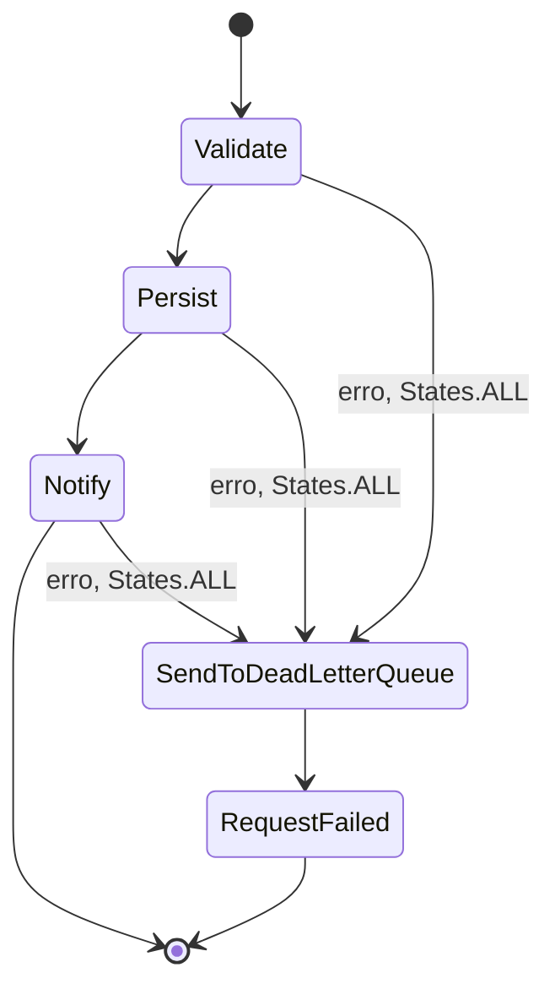
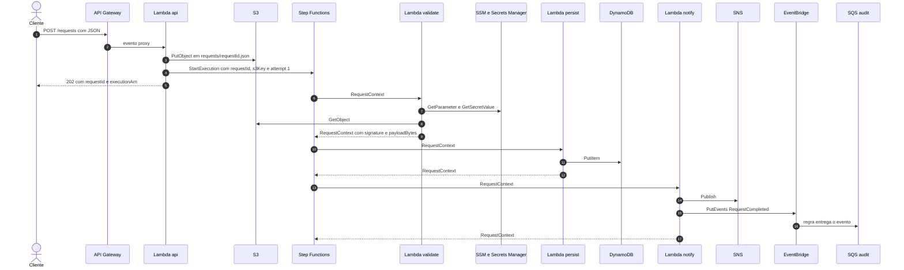
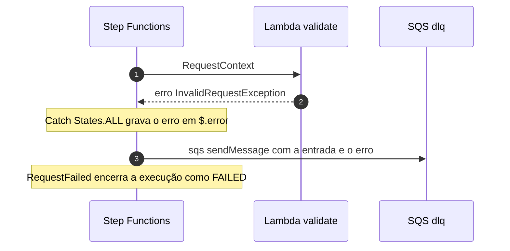
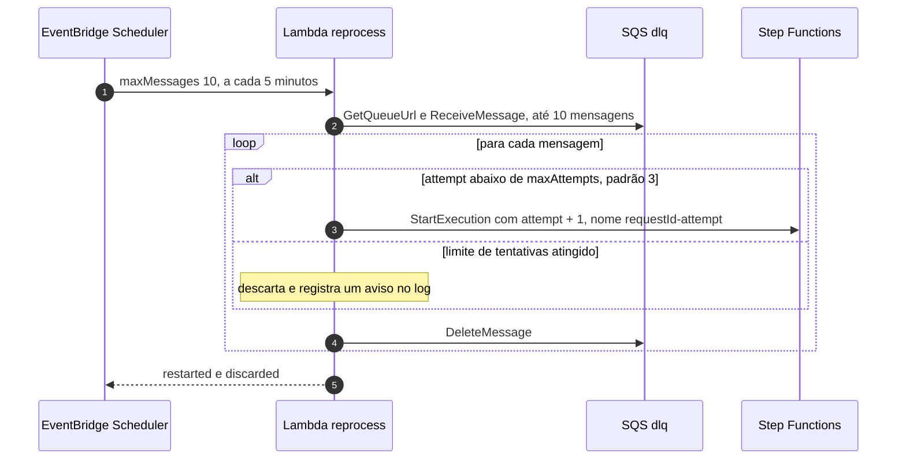
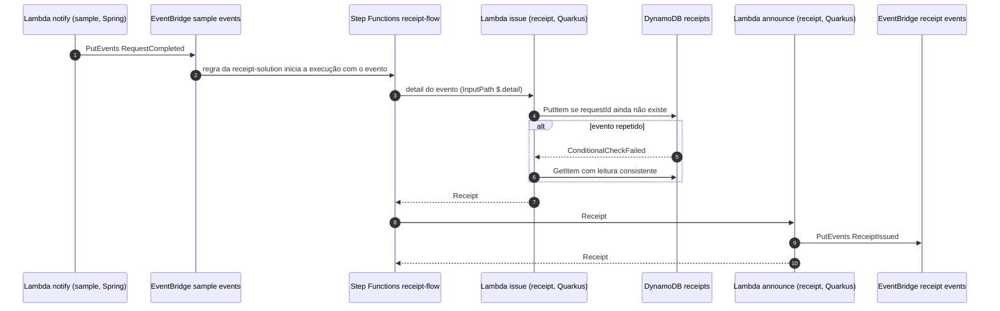
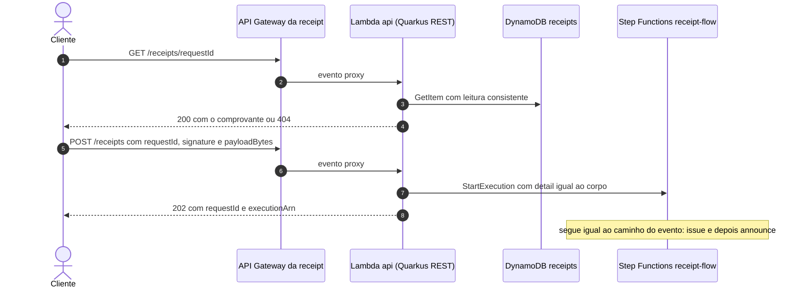

# Fluxos

Como uma requisição percorre a `sample-solution` e como o resultado aciona a `receipt-solution`. Os
componentes estão descritos em [Arquitetura](architecture.md); os formatos das mensagens, no
[AsyncAPI da sample](events/asyncapi.yaml) e no [da receipt](events/receipt-solution.asyncapi.yaml).

## Máquina de estado `request-flow`

Definida em `stepFunctions.stateMachines.requestFlow` no `sample-solution/serverless.yml`.

| Estado | Tipo | O que faz |
|---|---|---|
| `Validate` | Task, Lambda `validate` | Rejeita payload vazio ou acima do limite; assina o conteúdo com HMAC |
| `Persist` | Task, Lambda `persist` | Grava o resultado no DynamoDB |
| `Notify` | Task, Lambda `notify` | Publica no SNS e emite `RequestCompleted` no EventBridge |
| `SendToDeadLetterQueue` | Task, `arn:aws:states:::sqs:sendMessage` | Envia a entrada do estado que falhou, com o erro em `error`, para a DLQ |
| `RequestFailed` | Fail | Encerra a execução como `FAILED` com o erro `RequestFailed` |

Os três passos de negócio têm o mesmo `Catch`: qualquer erro (`States.ALL`) é gravado em `$.error`
e a execução segue para `SendToDeadLetterQueue`.

## Caminho de sucesso

O cliente recebe `202` assim que a execução é iniciada; o processamento continua de forma
assíncrona. O nome da execução é o `requestId` (e `requestId-attempt` nos reprocessamentos), o que
liga cada execução ao objeto no S3 e ao item no DynamoDB. O payload fica no S3 e só a chave trafega
na máquina de estado
([ADR 0006](decisions/0006-payload-no-s3.md)).

## Caminho de falha

Validado no Floci com um payload de 5012 bytes: o `validate` falhou com
`Payload of 5012 bytes exceeds the limit of 4096 bytes` e a mensagem chegou à DLQ com o campo
`error` (`Error` com o tipo da exceção e `Cause` com o JSON de erro do runtime da Lambda).

## Reprocessamento

A nova execução recomeça do `Validate`, com `signature` e `payloadBytes` limpos. Um payload que
sempre falha é reiniciado duas vezes e descartado na terceira tentativa
([ADR 0007](decisions/0007-dlq-e-reprocessamento.md)).

## Integração com a receipt-solution

A `receipt-solution`, em Quarkus, reage ao mesmo `RequestCompleted`. Uma regra que ela cria no
barramento da `sample-solution` inicia a máquina de estado `receipt-flow` direto, sem Lambda no meio
([ADR 0011](decisions/0011-integracao-entre-solucoes-por-eventbridge.md)).

O EventBridge entrega cada evento pelo menos uma vez, e o alvo nativo não deixa escolher o nome da
execução. Por isso o `issue` é idempotente: um evento repetido devolve o comprovante já emitido, com o
mesmo `issuedAt`. Os dois passos têm 2 novas tentativas, com intervalo inicial de 2 segundos. A
`sample-solution` não sabe que a `receipt-solution` existe: o contrato entre as duas é o evento.

## API da receipt-solution

A emissão manual entra na mesma máquina e no mesmo formato do evento, então reaproveita o `issue`
idempotente: emitir de novo para um `requestId` que já tem comprovante devolve o comprovante
existente e publica `ReceiptIssued` mais uma vez. Os contratos estão no
[OpenAPI da receipt](api/receipt-solution.openapi.yaml).

## Onde cada erro termina

| Situação | Resultado | Onde observar |
|---|---|---|
| `Content-Type` diferente de `application/json` | `415` sem corpo | Resposta HTTP |
| Corpo ausente | `400` sem corpo | Resposta HTTP |
| Método não mapeado, como `GET /requests` | `403` com `Missing Authentication Token`, devolvido pelo API Gateway | Resposta HTTP |
| Falha ao gravar no S3 ou iniciar a execução | `500` (não reproduzido nos testes) | Resposta HTTP e log da Lambda `api` |
| Payload vazio ou acima de 4096 bytes | Execução `FAILED` e mensagem na DLQ | Histórico da execução e fila `dlq` |
| Erro em `persist` ou `notify` | Execução `FAILED` e mensagem na DLQ | Histórico da execução e fila `dlq` |
| Falha repetida após 3 tentativas | Mensagem descartada | Log da Lambda `reprocess` (`Discarding request ...`) |
| Erro em `issue` ou `announce` (receipt-solution) | 2 novas tentativas; depois, execução `FAILED`, sem DLQ no exemplo | Histórico da execução `receipt-flow` |
| `RequestCompleted` entregue mais de uma vez | Mesmo comprovante; o `announce` pode publicar `ReceiptIssued` de novo | Tabela `receipts` e barramento da receipt-solution |
| `GET /receipts/{requestId}` sem comprovante | `404` sem corpo | Resposta HTTP |
| `POST /receipts` com campo ausente ou `payloadBytes` menor que 1 | `400` com a lista de violações, sem iniciar execução | Resposta HTTP |
| `POST /receipts` com `Content-Type` diferente de `application/json` | `415` sem corpo | Resposta HTTP |
