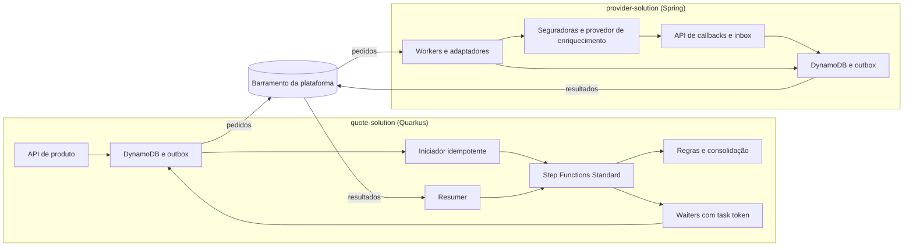

# PRD Backend — Plataforma de cotação de seguros

Versão: 2.1 • Data: 11/11/2026 • Status: especificação inicial implementável

### Alterações da versão 2.1

- Stack ajustada ao monorepo existente: Maven, AWS Lambda com Serverless Framework, DynamoDB e Floci para emulação local (§4).
- Implementação dividida em duas soluções, uma em Quarkus (`quote-solution`) e outra em Spring (`provider-solution`), que trocam eventos por um barramento da plataforma (§9 e §16).
- Seleção de oferta é definitiva no MVP (RN13); NOT_FOUND de enriquecimento obrigatório gera NEEDS_INFORMATION (§8).
- Definidos o significado de "pendência" na consolidação, o caminho único das seguradoras síncronas e assíncronas e o destino do workflow de versões substituídas (§8 e §9).
- Modelo de dados reescrito para DynamoDB, com os campos e entidades que o contrato compartilhado exige (§10).
- API inicial alinhada ao contrato compartilhado (§11); DLQ nas filas (§12); testes T23–T31 (§14); marcos M0–M7 (§15).
- A seção "Contrato compartilhado de integração — versão 2.0" ganhou só o campo `outcomeReason` no detalhe da versão, uma adição compatível aplicada igualmente ao PRD de frontend.

## 1. Resumo executivo

Construir uma plataforma que receba solicitações de cotação, obtenha informações externas com reutilização controlada, consulte seguradoras e disponibilize ofertas comparáveis e rastreáveis. AWS Step Functions Standard coordena as etapas; componentes Java implementam regras de negócio e integrações. A solução é uma implementação nova, entregue como duas soluções do monorepo serverless, com regras de negócio na aplicação e persistência protegida por escritas condicionais e transações.

O primeiro incremento será um laboratório funcional de seguro auto, com dados sintéticos, dois simuladores de seguradora — um síncrono e outro assíncrono — e um provedor simulado de enriquecimento. A conexão com fornecedores reais é uma etapa posterior condicionada a contratos e credenciais.

O documento inclui requisitos de produto e um anexo de decisões técnicas propostas. Não representa uma integração já implementada nem integração comercial homologada.

## 2. Problema, usuários e evidências

Processos de cotação dependem de consultas a serviços externos e precisam preservar solicitações e resultados para reuso. A solução pretende reduzir consultas redundantes, tornar o processo observável e manter regras de negócio testáveis na aplicação.

Não foram fornecidos contratos de seguradoras, volumes, custos ou indicadores atuais. Redução de custo e desempenho são hipóteses a medir, não resultados comprovados.

| Usuário           | Necessidade                                                                                                   |
| ----------------- | ------------------------------------------------------------------------------------------------------------- |
| Corretor/operador | Solicitar cotação, acompanhar pendências e comparar ofertas sem confundir falha técnica com recusa comercial. |
| Sistema parceiro  | Integrar via API idempotente e recuperar andamento e resultados.                                              |
| Operação técnica  | Identificar consultas paradas, callbacks não associados e falhas recuperáveis.                                |
| Engenharia        | Implementar regras com testes e implementar contratos independentes dos provedores.                           |

## 3. Objetivos e não objetivos

### Objetivos de negócio

- Evitar chamadas externas desnecessárias quando há resultado válido e autorizado para reuso.
- Preservar ofertas recebidas mesmo quando outra seguradora falha.
- Rastrear quais dados e regras fundamentaram cada resultado.
- Evoluir regras e integrações por contratos versionados.

### Objetivos do usuário

- Receber protocolo imediatamente após aceitação durável.
- Acompanhar ofertas parciais e estados por seguradora.
- Saber se precisa complementar dados ou aguardar recuperação técnica.
- Selecionar uma oferta válida para iniciar uma proposta futura.

### Fora do MVP

- Emissão de apólice, cobrança, pagamento, cancelamento e gestão de sinistros.
- Precificação atuarial própria: preços são produzidos pelas seguradoras/simuladores.
- Multi-region e motor genérico de regras.
- Reuso entre organizações diferentes; compartilhamento indiscriminado de dados pessoais.
- Portal público, SEO, aplicativo móvel e notificações por WhatsApp/e-mail.
- Análise manual prolongada dentro da mesma execução. No MVP, complementação cria nova versão.

## 4. Premissas e decisões de escopo

1. Seguro auto é o domínio de referência, a confirmar antes de uma implantação comercial.
2. Cada cotação possui identidade estável e versões imutáveis de seus dados relevantes.
3. Cada versão possui no máximo uma execução principal ativa.
4. Dados cadastrais podem ser reutilizados mediante política; ofertas não serão compartilhadas entre cotações no MVP. A reentrega da mesma solicitação recupera a mesma cotação.
5. O ambiente de aprendizado usa simuladores e dados sintéticos. Limites e validades abaixo são parâmetros de teste, não políticas das seguradoras.
6. Stack do MVP: Java 21, Maven, AWS Lambda (runtime `java21`, modo JVM) implantada pelo Serverless Framework, Step Functions Standard, SQS, EventBridge, S3 e DynamoDB. Seguindo o padrão do monorepo, cada solução usa um único framework: `quote-solution` em Quarkus (`platform/quarkus-parent`) e `provider-solution` em Spring (`platform/spring-parent`). As soluções não compartilham código nem tabelas; conversam por eventos.
7. Tabelas, índices, filas e máquinas de estado são declarados no `serverless.yml` de cada solução, versionados junto do código. Testes de integração de persistência usam o DynamoDB do Floci via `testcontainers-floci`. O MVP é validado no Floci nos marcos M1–M5 e numa conta AWS de desenvolvimento no M6.

## 5. Limite com o frontend

Este PRD especifica os serviços e contratos. Telas, componentes, interação e acessibilidade são definidos no prd-cotacao-seguros-frontend-v2.md. O frontend consome somente a API de produto; não acessa filas, banco, tokens de tarefa ou Step Functions diretamente.

## 6. Requisitos funcionais e critérios de aceite

| ID   | Requisito P0                                     | Critério de aceite                                                                                                                                                                            |
| ---- | ------------------------------------------------ | --------------------------------------------------------------------------------------------------------------------------------------------------------------------------------------------- |
| RF01 | Registrar cotação de forma durável e idempotente | Mesma organização, chave e conteúdo retornam a mesma identidade; conteúdo diferente com a mesma chave retorna 409.                                                                            |
| RF02 | Versionar entradas relevantes                    | Alterar risco/coberturas gera versão nova; versão anterior permanece consultável e não pode ser usada para nova seleção após substituição.                                                    |
| RF03 | Executar regras de elegibilidade na aplicação    | Mesmas entradas e versão de regra produzem a mesma decisão no conjunto de testes; recusa conhecida é resultado, não exceção técnica.                                                          |
| RF04 | Reutilizar enriquecimento válido                 | Resultado compatível, autorizado e dentro da idade máxima evita chamada externa; a decisão registra HIT e referência utilizada.                                                               |
| RF05 | Coordenar consultas equivalentes                 | Cem solicitações concorrentes da mesma chave no cenário normal geram um líder de consulta; seguidores recebem a mesma evidência. Falhas ambíguas não prometem exatamente uma chamada externa. |
| RF06 | Consultar seguradoras elegíveis                  | Lista é calculada por regra; cada item possui resultado independente e prazo próprio.                                                                                                         |
| RF07 | Suportar seguradora síncrona e assíncrona        | Ambos os simuladores produzem ofertas no mesmo contrato normalizado; callback duplicado não duplica oferta.                                                                                   |
| RF08 | Preservar resultados parciais                    | Oferta de A fica visível antes da conclusão de B; falha de B não apaga A.                                                                                                                     |
| RF09 | Tratar falhas por classificação                  | Recusa não dispara retry; erro transitório elegível possui tentativas limitadas; timeout ambíguo vai para reconciliação quando não há repetição segura.                                       |
| RF10 | Consolidar sem ambiguidade                       | Resultado distingue ausência comercial de oferta, pendência e impossibilidade técnica de concluir.                                                                                            |
| RF11 | Selecionar oferta                                | Oferta expirada, de versão substituída ou de outra organização não pode ser selecionada; seleção repetida é idempotente.                                                                      |
| RF12 | Recuperar trabalho interrompido                  | Queda entre persistência e publicação é recuperada por outbox; recuperação após callback não altera oferta já registrada.                                                                     |
| RF13 | Disponibilizar rastreabilidade                   | Cotação referencia workflow, regras, consultas, tentativas e ofertas, sem expor tokens ou credenciais ao usuário.                                                                             |

Histórias centrais: como corretor, quero receber ofertas mesmo com uma seguradora indisponível; como parceiro, quero repetir um envio após timeout sem criar nova cotação; como operador, quero identificar consultas com resultado desconhecido e reconciliá-las sem repetir cobranças indevidas. RF01, RF08, RF09 e RF12 são seus critérios de conclusão.

## 7. Regras de negócio

- RN01: cotação, proposta e emissão são ciclos distintos. Workflow SUCCEEDED significa execução técnica concluída, não aceitação comercial.
- RN02: snapshot de entrada, versão da regra e evidências utilizadas são imutáveis após processamento. Correções criam nova versão.
- RN03: chave de reuso inclui organização, provedor, operação, versão de contrato e parâmetros semanticamente relevantes normalizados. CPF/CNPJ isolado não identifica uma consulta.
- RN04: hash da chave não equivale a anonimização; usar identificadores opacos/HMAC quando necessário e não registrar identificadores pessoais em nomes de execução.
- RN05: elegibilidade de reuso exige resultado válido, idade aceitável e escopo permitido. TTL de armazenamento não decide validade comercial.
- RN06: informação expirada não pode ser usada no MVP. Stale fallback fica para evolução com autorização explícita por produto.
- RN07: NOT_FOUND é resultado válido somente quando declarado pelo provedor. Timeout, erro de autenticação ou payload inválido nunca são convertidos em NOT_FOUND.
- RN08: recusa de uma seguradora não significa recusa das demais; sem oferta por falha técnica não significa risco inelegível.
- RN09: todo resultado de seguradora se vincula à cotação, versão, seguradora e tentativa lógica; oferta contém validade própria.
- RN10: resposta tardia é preservada como evidência. No MVP, não reabre automaticamente uma cotação terminal nem se torna selecionável; nova versão pode ser solicitada.
- RN11: substituição de versão não garante cancelamento de operações já iniciadas no fornecedor. Resultados antigos continuam isolados por versão.
- RN12: precisão monetária usa decimal, moeda explícita e nenhuma conversão para ponto flutuante binário no cálculo/comparação de valores.
- RN13: seleção de oferta é definitiva no MVP. Depois dela, um NEEDS_INFORMATION de outra seguradora é apenas informativo e CREATE_VERSION deixa de constar em allowedActions; a cotação não fica aguardando complementação.
- RN14: desiredStartDate é data civil sem fuso (ISO 8601 `YYYY-MM-DD`), interpretada no fuso `America/Sao_Paulo`. Datas e horários com hora seguem em UTC.

## 8. Estados e consolidação

### Cotação

Separar phase, outcome e supersededAt para não misturar andamento, resultado e substituição.

- phase: RECEIVED → VALIDATING → ENRICHING → QUOTING → TERMINAL.
- outcome nulo até TERMINAL; valores: COMPLETED, PARTIAL, NEEDS_INFORMATION, INELIGIBLE, NO_OFFER, TECHNICAL_FAILURE.
- status comercial das ofertas é derivado de validUntil e das condições da cotação, sem reescrever seu conteúdo.

### Resultado por seguradora

PENDING → PROCESSING → QUOTED | DECLINED | NEEDS_INFORMATION | UNAVAILABLE | TIMED_OUT.

Estados terminais não são sobrescritos silenciosamente por callbacks tardios; estes geram registros de evidência e reconciliação.

### Precedência da consolidação

| Condição                                                               | outcome                                                                                                                    |
| ---------------------------------------------------------------------- | -------------------------------------------------------------------------------------------------------------------------- |
| Entrada incompleta identificada antes das consultas                    | NEEDS_INFORMATION                                                                                                          |
| Regra própria impede continuar                                         | INELIGIBLE                                                                                                                 |
| Enriquecimento obrigatório respondeu NOT_FOUND                         | NEEDS_INFORMATION; missingFields aponta a referência com reasonCode ENRICHMENT_NOT_FOUND e nenhuma seguradora é consultada |
| Nenhuma seguradora aplicável pela política                             | NO_OFFER com motivo NO_APPLICABLE_INSURER                                                                                  |
| Pelo menos uma oferta e todos os demais resultados são QUOTED/DECLINED | COMPLETED                                                                                                                  |
| Pelo menos uma oferta e há pendência ou falha técnica                  | PARTIAL                                                                                                                    |
| Sem oferta e existe NEEDS_INFORMATION                                  | NEEDS_INFORMATION; preservar falhas adicionais                                                                             |
| Sem oferta nem pendência, com falha técnica em alguma seguradora       | TECHNICAL_FAILURE                                                                                                          |
| Todas as seguradoras consultadas recusaram                             | NO_OFFER                                                                                                                   |

Se enriquecimento obrigatório falhar, encerrar TECHNICAL_FAILURE sem inventar informação. Todos os motivos por seguradora permanecem disponíveis, independentemente do outcome agregado. O motivo do outcome agregado (por exemplo, NO_APPLICABLE_INSURER) fica em outcomeReason.

Na consolidação, "pendência" significa resultado NEEDS_INFORMATION de alguma seguradora: como o Map aguarda todos os itens, não há PENDING nem PROCESSING nesse momento. TIMED_OUT e UNAVAILABLE contam como falha técnica.

## 9. Arquitetura e orquestração propostas



### Divisão entre as soluções

|                     | quote-solution (Quarkus)                                                                                                | provider-solution (Spring)                                                                                                               |
| ------------------- | ----------------------------------------------------------------------------------------------------------------------- | ---------------------------------------------------------------------------------------------------------------------------------------- |
| Papel               | Núcleo da cotação                                                                                                       | Ponte com fornecedores                                                                                                                   |
| HTTP                | API de produto: /v1/me, catálogo, cotações, versões, ofertas, seleção e /v1/operations                                  | POST /v1/providers/{provider}/callbacks e simuladores (seguradora síncrona, seguradora assíncrona e provedor de enriquecimento)          |
| Processamento       | Máquina principal, regras de elegibilidade, consolidação, seleção, outbox, waiters, resumer e reconciliação de cotações | Workers SQS de enriquecimento e de seguradoras, reuso com liderança, quota por provedor, inbox de callbacks e reconciliação de consultas |
| Motivo do framework | A meta de latência do produto (§12) é da API; Lambdas Quarkus sobem mais rápido que as Spring no modo JVM               | Trabalho assíncrono com prazo de até 90 s por seguradora, onde o cold start pesa pouco e a coordenação é mais complexa                   |

Integração entre as soluções:

- Uma stack própria em `platform/events` cria o barramento da plataforma e sobe antes das soluções. As duas soluções publicam nele e declaram, no próprio `serverless.yml`, regras com filas SQS próprias como alvo, cada uma com DLQ.
- Pares de pedido e resultado: EnrichmentRequested → EnrichmentResolved; InsurerQuoteRequested → InsurerResultRecorded; QueryReconcileRequested → QueryReconciled. A provider-solution também publica OperationIssueRaised e OperationIssueUpdated, que a quote-solution projeta em /v1/operations/issues.
- O contrato entre as soluções é o evento, documentado no AsyncAPI de cada solução. Consumidores são idempotentes e ignoram campos desconhecidos; cada evento produzido tem teste de contrato.
- As soluções existentes do monorepo continuam com barramento próprio; migrá-las para o barramento da plataforma é evolução separada.

### Entrada e início confiável

A API confirma cotação e evento StartQuoteRequested na mesma transação do DynamoDB. Publicador inicia execução com nome determinístico opaco associado à cotação/versão e input estável. Guarda executionArn. Se a resposta de início se perder, reconcilia antes de tentar criar outra execução. Nunca muda input ou nome aleatoriamente para contornar conflito.

### Máquina principal

1. LoadQuoteSnapshot.
2. EvaluateEligibility: regras Java sobre os dados de entrada, antes de qualquer chamada externa paga; Choice encaminha resultado. Regras que dependem de dado enriquecido pertencem a SelectInsurers.
3. ResolveEnrichment: pede à provider-solution a decisão HIT, JOIN ou MISS, aguarda as evidências e persiste suas referências.
4. SelectInsurers: retorna lista permitida para o risco, o produto e os dados enriquecidos.
5. QuoteInsurers: Map dinâmico; cada item executa pedido, espera, normalização e persistência próprios.
6. ConsolidateQuote: aplica tabela de precedência com atualização condicional.
7. RecordCompletion: grava evento de conclusão em outbox de forma idempotente.

Quando uma versão é substituída, o workflow dela segue até o fim, sem StopExecution no MVP. Os resultados ficam isolados por versão, e as chamadas feitas continuam contando na quota do provedor.

Cada item do Map captura falhas externas conhecidas e produz resultado normalizado. Falhas de programação não devem ser rotuladas como recusa comercial. Erros fatais do workflow são reconciliados na base por observação de execução e varredura periódica; não depender exclusivamente de Catch.

O Map aguarda os itens terminarem. Resultados parciais são publicados na base por cada item antes da consolidação. O MVP não encerra antecipadamente ao atingir um quorum de ofertas.

### Pedidos com task token e retomada

- ResolveEnrichment e cada item do Map usam uma Lambda com integração waitForTaskToken. Ela grava, na mesma transação, o WorkflowWaiter com o token cifrado e um evento de outbox que leva apenas um workRef opaco.
- O publicador da outbox entrega o pedido no barramento da plataforma (EnrichmentRequested ou InsurerQuoteRequested). O token nunca sai da quote-solution: não vai para a provider-solution, para fornecedores nem para o frontend. Só a quote-solution tem permissão IAM de SendTaskSuccess.
- Seguradoras síncronas e assíncronas usam o mesmo caminho. Na síncrona, o worker já recebe a oferta na chamada; na assíncrona, a oferta chega pela API de callbacks.
- Worker cria correlação durável antes de chamar o fornecedor, quando o protocolo permite; registra providerRequestId após aceitação.
- Worker confirma/remove mensagem SQS após persistir o encaminhamento, sem aguardar oferta na fila.
- Receptor de callback verifica assinatura/autenticação, persiste inbox e associa correlação.
- A provider-solution grava o resultado normalizado e o evento de resultado (EnrichmentResolved ou InsurerResultRecorded, com o workRef) na mesma transação.
- Na quote-solution, o resumer grava InsurerResult, Offer ou QuoteEvidence e a intenção de SendTaskSuccess atomicamente; um publicador retoma o workflow e controla reentregas pelo workRef.
- DECLINED pode ser entregue por SendTaskSuccess como resultado comercial válido. Não usar SendTaskFailure para recusa comercial.
- Callback não correlacionado fica na inbox para recuperação; duplicado é reconhecido por identidade externa ou chave estável.
- Token expirado exige classificação e reconciliação, não retry infinito. Timeout da tarefa não cancela o efeito externo.

### Concorrência e reuso

Essa coordenação pertence à provider-solution. Índice de reuso aponta para evidência imutável; atualização usa versão/ordenação para impedir resultado antigo de substituir novo. Aquisição de liderança usa escrita condicional; sem transação aberta durante HTTP.

Consultas em andamento mantêm leaseUntil e fencingVersion. Retomada após expiração incrementa a versão; líder antigo não pode publicar como proprietário atual. Uma lease expirada não autoriza automaticamente repetir consulta externa com efeito/cobrança: consultar status primeiro quando houver ambiguidade.

Seguidores registram espera durável vinculada à consulta compartilhada. Cada pedido que entra como JOIN recebe o próprio EnrichmentResolved com o seu workRef quando a consulta compartilhada termina. Não guardar apenas um task token em consulta compartilhada, pois diferentes workflows podem depender dela.

Concorrência por execução não é limite global por seguradora. Adaptadores aplicam quota compartilhada por provedor/credencial; teste inclui múltiplos workflows simultâneos.

### Parâmetros iniciais de laboratório

| Parâmetro                            | Valor inicial proposto                                     |
| ------------------------------------ | ---------------------------------------------------------- |
| Prazo total por cotação              | 5 minutos                                                  |
| Prazo por seguradora                 | 90 segundos, limitado pelo prazo restante                  |
| Map concurrency                      | 2                                                          |
| Retry transitório seguro             | Até 2 retries, além da tentativa inicial, backoff e jitter |
| Validade de enriquecimento simulado  | 15 minutos                                                 |
| Validade de oferta simulada          | 30 minutos                                                 |
| Orientação de atualização ao cliente | retryAfterSeconds configurável, inicialmente 3             |

Valores são configuráveis e devem ser revisados após medir e obter contratos. O orçamento da etapa inclui fila, execução e retries. Evitar retry simultâneo no SDK, worker e workflow sem orçamento combinado.

## 10. Modelo de dados lógico

| Entidade           | Solução  | Campos essenciais e invariantes                                                                                                                                                                                                                                                                                                                 |
| ------------------ | -------- | ----------------------------------------------------------------------------------------------------------------------------------------------------------------------------------------------------------------------------------------------------------------------------------------------------------------------------------------------- |
| Quote              | quote    | id, organizationId, createdBy, currentVersion, createdAt. Acesso sempre por organização.                                                                                                                                                                                                                                                        |
| QuoteVersion       | quote    | quoteId, version, snapshotRef, inputHash, phase, outcome, outcomeReason, missingFields, ruleVersion, workflowVersion, executionArn, deadlineAt, supersededAt, revision. Única por quoteId/version.                                                                                                                                              |
| IdempotencyRecord  | quote    | organizationId, operation, scope, key, requestHash, resourceRef, createdAt. Única por organização/operação/escopo/chave; nas operações sobre versões e seleção, o escopo é a cotação. requestHash é SHA-256 do body em JSON canônico (RFC 8785). Sem expiração curta no laboratório.                                                            |
| QuoteEvidence      | quote    | quoteId, version, evidenceId, reuseDecision, policyVersion. Mantém proveniência por cotação.                                                                                                                                                                                                                                                    |
| InsurerResult      | quote    | quoteId, version, insurerId, status, reasonCode, queryRef, attemptRef. Única por cotação/versão/seguradora no MVP.                                                                                                                                                                                                                              |
| Offer              | quote    | id, insurerResultId, externalOfferId, premiumTotal, currency, installments, coverages, deductibles, validUntil, rawResponseRef. Oferta imutável.                                                                                                                                                                                                |
| QuoteSelection     | quote    | selectionId, quoteId, version, offerId, selectedAt, selectedBy. Uma seleção por versão, definitiva no MVP (RN13).                                                                                                                                                                                                                               |
| WorkflowWaiter     | quote    | workRef, executionArn, tokenEncrypted, expiresAt, status. Segredo operacional; nunca sai da quote-solution.                                                                                                                                                                                                                                     |
| OperationIssue     | quote    | id, type, status, queryId opcional, quoteId opcional, firstSeenAt, lastSeenAt, safeSummary. Projeção de eventos da provider-solution e de falhas da própria quote-solution.                                                                                                                                                                     |
| ReconcileOperation | quote    | operationId, queryId, reason, requestedBy, status (QUEUED, RUNNING, SUCCEEDED, FAILED), safeSummary, updatedAt. Auditoria da reconciliação manual.                                                                                                                                                                                              |
| ExternalQuery      | provider | id, queryKey, provider, operation (ENRICH ou QUOTE), contractVersion, state, leaseUntil, fencingVersion, providerRequestId. Estado técnico separado do resultado: PENDING, IN_FLIGHT, COMPLETED, FAILED ou UNKNOWN (resultado ambíguo que exige reconciliação). Pedidos de cotação a seguradoras também são ExternalQuery, sem índice de reuso. |
| QueryAttempt       | provider | id, queryId, sequence, startedAt, finishedAt, outcome, errorClass, providerRequestId. Não sobrescrever tentativas anteriores.                                                                                                                                                                                                                   |
| QueryEvidence      | provider | id, queryId, normalizedResultRef, rawResponseRef, observedAt, receivedAt, reusableUntil, resultType, checksum. Imutável.                                                                                                                                                                                                                        |
| ReuseIndex         | provider | queryKey, evidenceId, revision. Ponteiro para evidência elegível mais recente; só para operation ENRICH.                                                                                                                                                                                                                                        |
| CallbackInbox      | provider | id, provider, externalEventId, correlationId, payloadRef, receivedAt, processingStatus. Deduplicação por provedor/evento.                                                                                                                                                                                                                       |
| ProviderQuota      | provider | provider, credentialRef, window, used, limit. Atualização condicional; vale para todos os workflows.                                                                                                                                                                                                                                            |
| Outbox             | ambas    | id, aggregateId, eventType, payloadRef, createdAt, publishedAt, attempts. Publicação pelo menos uma vez; consumidores idempotentes.                                                                                                                                                                                                             |

### Mapeamento para DynamoDB

- quote-solution, tabela única `quotes`: partição `QUOTE#<quoteId>` com itens `META`, `V#<n>`, `V#<n>#RESULT#<insurerId>`, `V#<n>#OFFER#<offerId>`, `V#<n>#SELECTION` e `V#<n>#EVIDENCE#<evidenceId>`; itens auxiliares `IDEMPOTENCY#…`, `WAITER#<workRef>`, `OUTBOX#<id>`, `ISSUE#<id>` e `OPERATION#<id>`. Um índice secundário com partição `ORG#<organizationId>` e ordenação `<createdAt>#<quoteId>` atende a listagem por cursor, com filtros de phase, outcome e período.
- provider-solution, tabela única `queries`: partição `QUERY#<id>` com `META`, `ATTEMPT#<sequence>` e `EVIDENCE#<id>`; itens `REUSE#<queryKey>`, `INFLIGHT#<queryKey>` (liderança com leaseUntil e fencingVersion), `INBOX#<provider>#<externalEventId>`, `QUOTA#<provider>#<window>` e `OUTBOX#<id>`.
- Unicidade usa escrita condicional (`attribute_not_exists`). Mudanças que precisam ser atômicas, como cotação com idempotência e outbox, ou resultado com outbox, usam `TransactWriteItems`.
- A outbox é publicada por DynamoDB Streams com uma Lambda; se o Floci não suportar Streams, um publicador agendado lê os itens pendentes.
- O desenho detalhado de chaves e índices é registrado em ADR antes do código (M0).

S3 armazena payloads grandes; estados do workflow carregam referências e resumos. Escrita no S3 e no DynamoDB não é atômica: usar chave determinística/checksum, confirmar objeto antes de referenciá-lo como disponível e limpar órfãos posteriormente. A base de negócio é fonte de consulta do produto, não o histórico temporário da execução.

## 11. API inicial

Autenticação por OIDC/OAuth com validação de access token; identidade da organização vem do contexto autorizado, nunca apenas de um campo livre do body. Respostas não incluem taskToken ou dados brutos sensíveis.

O contrato compartilhado, ao final deste documento, prevalece sobre esta tabela em caso de divergência.

| Método e rota                                                       | Solução  | Contrato                                                                                                                              |
| ------------------------------------------------------------------- | -------- | ------------------------------------------------------------------------------------------------------------------------------------- |
| GET /v1/me                                                          | quote    | Usuário, organização e permissões.                                                                                                    |
| GET /v1/catalog/customers, /vehicles, /drivers e /coverage-profiles | quote    | Fixtures autorizadas do laboratório, com search e cursor.                                                                             |
| POST /v1/quotes                                                     | quote    | Idempotency-Key obrigatório. Cria snapshot; 202 + quoteId, version, phase, statusUrl.                                                 |
| GET /v1/quotes                                                      | quote    | Paginação por cursor; filtros phase, outcome, createdFrom e createdTo; escopo da organização.                                         |
| GET /v1/quotes/{id}/versions/{v}                                    | quote    | Fase, resultado, pendências, estados por seguradora e progresso.                                                                      |
| GET /v1/quotes/{id}/versions/{v}/offers                             | quote    | Ofertas parciais, validade e comparação de coberturas.                                                                                |
| POST /v1/quotes/{id}/versions                                       | quote    | Idempotency-Key, expectedVersion e novo snapshot; conflito concorrente retorna 409.                                                   |
| POST /v1/quotes/{id}/versions/{v}/selection                         | quote    | offerId e Idempotency-Key; cria intenção definitiva, não emite proposta.                                                              |
| GET /v1/operations/issues                                           | quote    | Restrito; projeção de OperationIssue, sem tokens nem payload bruto.                                                                   |
| POST /v1/operations/queries/{id}/reconcile                          | quote    | Operador autorizado registra ReconcileOperation com motivo e auditoria; a quote-solution publica QueryReconcileRequested.             |
| GET /v1/operations/{operationId}                                    | quote    | Situação da reconciliação.                                                                                                            |
| POST /v1/providers/{provider}/callbacks                             | provider | Autenticação específica do provedor; confirmação somente após inbox durável. Endpoint exposto a fornecedores, fora da API de produto. |

Exemplo ilustrativo de criação:

```json
{
  "product": "AUTO",
  "applicantRef": "customer-123",
  "risk": {
    "vehicleRef": "vehicle-456",
    "usage": "PERSONAL",
    "principalDriverRef": "driver-789"
  },
  "coverageProfile": "COMPREHENSIVE",
  "desiredStartDate": "2026-12-01"
}
```

Referências são resolvidas e copiadas para snapshot autorizado; mudanças posteriores no cadastro não alteram a versão já aceita. O schema comercial completo será definido pelo primeiro contrato real.

Erro padrão: code, message, correlationId e fieldErrors opcionais. HTTP 400 para estrutura inválida; 401/403 para acesso; 404 para recurso não acessível conforme política; 409 para conflito de chave/versão/oferta; 429 para quota do produto; 503 quando não foi possível aceitar duravelmente. Recusas durante processamento aparecem no recurso, não como 500 da criação.

Não haverá cobrança aos usuários no MVP. Chamadas de fornecedor terão contadores de consumo; preços unitários reais permanecem configuração futura, nunca valores presumidos.

## 12. Requisitos não funcionais, segurança e operação

- Meta de laboratório: POST p95 até 1 segundo e GET p95 até 500 ms, sob 10 criações/s durante 5 minutos, excluída a duração do processamento assíncrono. Metas propostas, não capacidade comprovada.
- Teste de concorrência deve demonstrar isolamento entre organizações e redução de chamadas equivalentes.
- IAM roles por componente; privilégio mínimo; TLS; segredos fora do código; dados privados em S3; proteção de task tokens e credenciais.
- Logs com quoteId, version, queryId e correlationId; sem CPF, resposta integral ou segredo. Avaliar logging de payload no Step Functions para evitar exposição de dados pessoais.
- Retenção por classe de dado configurável. Laboratório apenas sintético; produção bloqueada até definir prazos, permissões de reutilização e regras contratuais com responsáveis.
- Deploy reproduzível pelo Serverless Framework; workflow e regra versionados; registrar versões efetivas na cotação. Mudança de alias não deve alterar retroativamente a regra de uma execução em andamento.
- Toda fila SQS tem DLQ com limite de recebimentos e caminho de reprocessamento, no padrão já adotado pelo monorepo. O limite de recebimentos entra no orçamento de retries do §9.
- Alarme para outbox envelhecida, callbacks não associados, consultas UNKNOWN, tarefas expiradas e aumento de falhas por provedor.
- Processo periódico reconcilia cotações não terminais cujo workflow terminou/expirou, consultas sem progresso e callbacks sem confirmação. Nunca reexecuta cegamente uma chamada potencialmente cobrada.
- Runbooks: provedor indisponível; callback tardio; publicação interrompida; falha do workflow; vazamento de segredo; rollback de deploy.
- Disponibilidade, RTO e RPO comerciais são decisões pendentes. Não lançar produção sem metas e exercício de recuperação definidos.

## 13. Métricas e eventos

| Métrica                      | Definição e uso                                                      |
| ---------------------------- | -------------------------------------------------------------------- |
| Taxa de reuso                | HIT / avaliações de reuso elegíveis; JOIN medido separadamente.      |
| Chamadas por cotação         | Tentativas externas reais / versões aceitas.                         |
| Tempo até primeira oferta    | Primeira oferta persistida menos aceitação durável.                  |
| Tempo até conclusão          | Terminal menos aceitação durável; segmentar por outcome.             |
| Cotações com oferta          | Versões com pelo menos uma oferta / versões elegíveis.               |
| Falha técnica por seguradora | Resultados técnicos / consultas àquela seguradora.                   |
| Pendências de reconciliação  | Quantidade e idade do estado UNKNOWN ou callback não associado.      |
| Custo por cotação            | Custo atribuível de infraestrutura e provedor / versões processadas. |

Eventos mínimos: QuoteAccepted, ReuseEvaluated, ExternalQueryStarted, ExternalQueryCompleted, InsurerResultRecorded, QuoteCompleted, OfferSelected. Não incluir dados pessoais nos eventos analíticos.

Guardrails: nenhuma oferta duplicada nos testes; nenhuma leitura entre organizações; zero resultados expirados selecionados; 100% das ofertas com proveniência. A meta comercial de redução de custo será definida após baseline; não impor percentual arbitrário.

## 14. Matriz de testes de aceitação

| Caso                                               | Resultado esperado                                                                                                                              |
| -------------------------------------------------- | ----------------------------------------------------------------------------------------------------------------------------------------------- |
| T01: fluxo normal com duas seguradoras             | Duas ofertas, COMPLETED, evidências vinculadas.                                                                                                 |
| T02: reenvio com mesma chave/body                  | Mesma cotação, nenhuma execução adicional.                                                                                                      |
| T03: mesma chave/body diferente                    | 409, sem alteração da cotação existente.                                                                                                        |
| T04: HIT de enriquecimento                         | Nenhuma chamada externa; referência da evidência preservada.                                                                                    |
| T05: enriquecimento expirado                       | Nova consulta, histórico anterior intacto.                                                                                                      |
| T06: cem consultas equivalentes concorrentes       | Um líder em ausência de falhas; seguidores terminam com a mesma evidência.                                                                      |
| T07: seguradora A oferece e B recusa               | COMPLETED com uma oferta e motivo da recusa.                                                                                                    |
| T08: A oferece e B expira                          | Oferta visível antes; outcome PARTIAL ao concluir.                                                                                              |
| T09: todas recusam                                 | NO_OFFER, sem retry comercial.                                                                                                                  |
| T10: todas indisponíveis                           | TECHNICAL_FAILURE, não NO_OFFER.                                                                                                                |
| T11: callback duplicado                            | Uma oferta e processamento idempotente da retomada.                                                                                             |
| T12: callback antes da correlação completa         | Inbox retém e reconciliação associa, sem perda.                                                                                                 |
| T13: resultado salvo e retomada falha              | Outbox recupera, sem chamar seguradora novamente.                                                                                               |
| T14: timeout após fornecedor aceitar               | Estado ambíguo reconciliado; sem repetição insegura.                                                                                            |
| T15: líder antigo retorna após lease transferida   | Fencing impede sobrescrita; evidência é preservada para avaliação.                                                                              |
| T16: callback após prazo final                     | Evidência tardia registrada; cotação terminal não reabre.                                                                                       |
| T17: nova versão durante consulta antiga           | Resultados isolados; seleção na versão substituída bloqueada.                                                                                   |
| T18: oferta expirada/organização diferente         | Seleção rejeitada sem criar intenção de proposta.                                                                                               |
| T19: queda após commit da criação                  | Outbox inicia workflow posteriormente.                                                                                                          |
| T20: falha fatal no workflow                       | Reconciliação atualiza base e gera alerta sem apagar ofertas.                                                                                   |
| T21: múltiplos workflows no mesmo provedor         | Quota global respeitada, não só Map concurrency.                                                                                                |
| T22: contrato frontend/backend                     | Schemas, enums, permissões e fixtures idênticos nos dois consumidores; erros e resultados parciais exercitados.                                 |
| T23: regra própria recusa o risco                  | INELIGIBLE, nenhuma consulta externa.                                                                                                           |
| T24: entrada incompleta antes das consultas        | NEEDS_INFORMATION com missingFields; nenhuma seguradora consultada.                                                                             |
| T25: enriquecimento obrigatório responde NOT_FOUND | NEEDS_INFORMATION com reasonCode ENRICHMENT_NOT_FOUND; nenhuma seguradora consultada.                                                           |
| T26: nenhuma seguradora aplicável                  | NO_OFFER com outcomeReason NO_APPLICABLE_INSURER.                                                                                               |
| T27: falha do enriquecimento obrigatório           | TECHNICAL_FAILURE, sem consultar seguradoras nem inventar dados.                                                                                |
| T28: seleção repetida e troca de oferta            | Mesma oferta retorna a seleção existente; outra oferta retorna 409 SELECTION_ALREADY_EXISTS.                                                    |
| T29: corrida entre seleção e nova versão           | Apenas uma ação vence; após a seleção, nova versão retorna 409 QUOTE_ALREADY_SELECTED e NEEDS_INFORMATION posterior não oferece CREATE_VERSION. |
| T30: usuário sem permissão                         | 403 em seleção e reconciliação sem offers:select ou operations:reconcile.                                                                       |
| T31: mensagem falha repetidamente                  | Vai para a DLQ após o limite e o reprocessamento não duplica resultado nem chamada externa.                                                     |

Testes unitários para regras; integração para unicidade/transações/inbox/outbox; contratos para adaptadores e para os eventos entre as soluções; testes em conta AWS de desenvolvimento para callback, IAM, timeout e recuperação reais. Simulador local não comprova o comportamento gerenciado do Step Functions.

## 15. Plano incremental e aprendizado

Estimativas relativas para orientar sequência, sujeitas à capacidade da equipe; não são compromissos de prazo.

| Marco                       | Duração indicativa        | Entrega e conhecimento consolidado                                                                                                                                                                                                                                      |
| --------------------------- | ------------------------- | ----------------------------------------------------------------------------------------------------------------------------------------------------------------------------------------------------------------------------------------------------------------------- |
| M0 — Fundação               | A estimar                 | ADRs da divisão entre soluções, do barramento da plataforma e do modelo DynamoDB; stack `platform/events`; esqueleto dos módulos; verificação no Floci de waitForTaskToken, Map dinâmico, TransactWriteItems, DynamoDB Streams e regra entre stacks com fila como alvo. |
| M1 — Corte vertical         | 1–2 semanas               | API, snapshot, idempotência, outbox, workflow mínimo e uma seguradora síncrona simulada atendida pela provider-solution via barramento; compreender Task/Choice, task token e aceitação durável. Medir o p95 da API.                                                    |
| M2 — Reuso                  | 1–2 semanas               | Evidências, chave, validade, liderança, JOIN, lease e fencing; NOT_FOUND; compreender cache versus histórico e concorrência.                                                                                                                                            |
| M3 — Assíncrono             | 1–2 semanas               | Seguradora assíncrona, callbacks com inbox, Map com duas seguradoras, resultados parciais e quota por provedor.                                                                                                                                                         |
| M4 — Falhas                 | 1 semana                  | Retry, prazos, DLQ, fencing, reconciliação e alarmes.                                                                                                                                                                                                                   |
| M5 — Contrato integrado     | 1 semana                  | APIs de identidade, catálogo, operação e seleção; OpenAPI e fixtures; validar consumo pelo frontend e medir tempo até primeira oferta.                                                                                                                                  |
| M6 — AWS de desenvolvimento | A estimar                 | Stage `dev` com parâmetros próprios, deploy das três stacks e repetição dos testes que o Floci não comprova (task token, IAM, timeouts).                                                                                                                                |
| M7 — Provedor real          | A estimar após descoberta | Integrar seguradora homologada; validar contratos e políticas reais.                                                                                                                                                                                                    |

Testes por marco: M1 executa T01 com uma seguradora, T02, T03, T19, T23 e T24; M2 executa T04, T05, T06, T15, T25 e T27; M3 executa T01 completo, T07, T08, T11, T12, T21 e T26; M4 executa T09, T10, T13, T14, T16, T17, T20 e T31; M5 executa T18, T22, T28, T29 e T30; M6 repete na AWS os cenários de callback, IAM, timeout e recuperação.

Ao terminar cada marco, produzir um pequeno ADR explicando uma decisão e demonstrar uma falha injetada. Exemplos: worker cai após envio; callback é duplicado; oferta chega depois do prazo. O aprendizado é comprovado pela recuperação observada, não apenas pelo caminho feliz.

## 16. Handoff para implementação

Estrutura no monorepo, seguindo o padrão das soluções existentes:

- platform/events: `serverless.yml` do barramento da plataforma, implantado antes das soluções.
- quote-solution (parent `quarkus-parent`):
  - domain: regras e estados da cotação, sem SDK AWS.
  - api: API de produto e autorização.
  - functions: tarefas da máquina, waiters, resumer, publicador da outbox e reconciliação de cotações.
  - e2e: cenários ponta a ponta no Floci.
  - `serverless.yml`: máquina principal (ASL), tabela, filas, DLQs e regras no barramento da plataforma.
- provider-solution (parent `spring-parent`, com `platform/spring-aws`):
  - domain: reuso, validade, coordenação e contratos normalizados de provedores, sem SDK AWS.
  - api: callbacks e inbox.
  - functions: workers de enriquecimento e de seguradoras, quota, publicador da outbox e reconciliação de consultas.
  - simulators: seguradora síncrona, seguradora assíncrona e provedor de enriquecimento, com atrasos e falhas configuráveis.
  - e2e: cenários ponta a ponta no Floci.
  - `serverless.yml`: tabela, filas, DLQs e regras no barramento da plataforma.
- contracts/openapi.yaml e contracts/fixtures: contrato da API de produto, conforme o contrato compartilhado.
- contracts/quote-solution/asyncapi.yaml e contracts/provider-solution/asyncapi.yaml: eventos entre as soluções.

Os módulos domain e simulators são novos em relação às soluções existentes, que têm só api, functions e e2e.

Configurações mínimas: nomes das tabelas DynamoDB, nome do barramento da plataforma, WORKFLOW_ARN, filas, bucket de payloads, emissor/audiência OIDC, endpoints dos provedores, referências de segredos de callback, chave de cifra dos task tokens, prazos e quotas. Nenhum segredo literal em Git ou ASL. Os `params` do `serverless.yml` ganham o stage `dev` no M6.

Ordem de implementação: barramento da plataforma → domínio e estados → persistência/idempotência/outbox → API → workflow simples com pedido via barramento → simuladores → reuso → callback/Map → reconciliação → testes de contrato com frontend → validação na AWS. Não implementar emissão como extensão incidental.

### Definition of Done do MVP

- Fluxo integral demonstrado em ambiente AWS de desenvolvimento com dois simuladores.
- T01–T31 aprovados.
- Deploy reproduzível pelo Serverless Framework, rollback de aplicação documentado e cleanup de laboratório disponível.
- Métricas e logs permitem seguir uma cotação sem expor dados sensíveis.
- Nenhum segredo/task token em saída pública ou logs.
- Runbooks e ADRs entregues; operadores conseguem reconciliar uma consulta interrompida.
- API distingue oferta, recusa, indisponibilidade, pendência e expiração; contrato permite renderização sem inferência do cliente.
- Custos observados no laboratório registrados; valores comerciais não inventados.

## 17. Riscos e decisões pendentes

| Item                               | Efeito                                                    | Decisão necessária                                                                    |
| ---------------------------------- | --------------------------------------------------------- | ------------------------------------------------------------------------------------- |
| Produto real e campos obrigatórios | Altera regras, contratos e normalização                   | Confirmar ramo de seguro e primeira seguradora.                                       |
| Contratos de reuso                 | Pode limitar cache e compartilhamento                     | Definir política por fornecedor e finalidade antes de dados reais.                    |
| Persistência de referência         | Influencia custo, transações e operação                   | Resolvido na v2.1: DynamoDB, no padrão do monorepo; desenho de chaves em ADR no M0.   |
| Recursos do Floci                  | Task token, Streams ou transações podem não ser emulados  | Verificar no M0; sem suporte, usar publicador agendado e validar o restante no M6.    |
| Desenho de chaves do DynamoDB      | Erro custa migração de dados e reescrita de consultas     | Registrar padrões de acesso e chaves em ADR antes do código.                          |
| Barramento compartilhado           | Regra com filtro errado entrega evento a quem não deveria | Filtrar por source e detail-type; teste de contrato por evento.                       |
| APIs sem idempotência/status       | Timeout pode gerar cobrança duplicada                     | Política de reconciliação e intervenção manual.                                       |
| Volume e SLA desconhecidos         | Dimensionamento e orçamento incertos                      | Medir baseline e definir metas de produção.                                           |
| Propostas reais                    | Seleção pode exigir reprecificação                        | Especificar novo PRD antes de envio/emissão.                                          |
| Comparabilidade de ofertas         | Coberturas podem ser diferentes                           | Normalização homologada por especialista de produto.                                  |
| Identidades e cadastros reais      | Determinam referências permitidas                         | MVP com fixtures sintéticas; homologar fonte cadastral antes da integração comercial. |

## 18. Referências técnicas

Referências oficiais consultadas na discussão que originou este PRD; conferir limites e capacidades novamente na implementação:

- [Tipos de workflow](https://docs.aws.amazon.com/step-functions/latest/dg/choosing-workflow-type.html): escolha de Standard para callback e longa duração.
- [Padrões de integração](https://docs.aws.amazon.com/step-functions/latest/dg/connect-to-resource.html): request-response, sync e task token.
- [Boas práticas de Step Functions](https://docs.aws.amazon.com/step-functions/latest/dg/sfn-best-practices.html): timeouts e referências S3 para payloads grandes.
- [HTTP Tasks](https://docs.aws.amazon.com/step-functions/latest/dg/call-https-apis.html): limite de 60 segundos, incompatível com espera longa por fornecedor.

Os diagramas e modelos deste documento são propostas para implementação. As políticas comerciais precisam ser confirmadas com o produto e os fornecedores.

## Contrato compartilhado de integração — versão 2.0

Esta seção é reproduzida nos dois PRDs e deve permanecer idêntica. O backend é responsável pelo contrato OpenAPI; frontend e simuladores usam os mesmos schemas e fixtures. Alterações incompatíveis exigem revisão dos dois PRDs. Datas/horários são ISO 8601 em UTC; valores monetários são strings decimais acompanhadas de moeda; IDs são opacos.

### Identidade, dados de entrada e permissões

- GET /v1/me retorna userId, displayName, organizationId e permissions. Permissões do MVP: quotes:read, quotes:write, offers:select, operations:read, operations:reconcile.
- Para o laboratório, GET /v1/catalog/customers, /vehicles e /drivers retornam fixtures autorizadas com id e label; aceitam search e cursor. GET /v1/catalog/coverage-profiles retorna códigos, rótulos e resumo das coberturas simuladas. Não implementar cadastro completo neste MVP.
- Criação exige product=AUTO, applicantRef, risk.vehicleRef, risk.usage (PERSONAL ou COMMERCIAL), risk.principalDriverRef, coverageProfile e desiredStartDate. Formato e referências são validados no servidor. O backend resolve referências para snapshot imutável; o frontend não precisa digitar IDs.
- O servidor é autoridade de organização e autorização em todos os endpoints. Esconder botão não autoriza recurso.

### Endpoints e resposta

| Endpoint                                    | Contrato compartilhado                                                                                                                                                                           |
| ------------------------------------------- | ------------------------------------------------------------------------------------------------------------------------------------------------------------------------------------------------ |
| POST /v1/quotes                             | Header Idempotency-Key; body acima; 202 com quoteId, version, phase, statusUrl. Repetição idêntica retorna mesma identidade.                                                                     |
| GET /v1/quotes                              | cursor, phase, outcome, createdFrom, createdTo; retorna items e nextCursor; resumo com id, currentVersion, phase, outcome, createdAt e offerCount.                                               |
| GET /v1/quotes/{id}/versions/{v}            | Snapshot autorizado, phase, outcome, outcomeReason, currentVersion, supersededAt, revision, updatedAt, serverTime, retryAfterSeconds, missingFields, insurerResults, selection, allowedActions.  |
| GET /v1/quotes/{id}/versions/{v}/offers     | Lista com revision, serverTime, items e nextCursor; item contém id, insurerId/name, premiumTotal, currency, installments, coverages, deductibles, validUntil, selectable e unavailabilityReason. |
| POST /v1/quotes/{id}/versions               | Idempotency-Key, expectedVersion e novo snapshot; 202 com version/statusUrl; divergência de expectedVersion retorna 409.                                                                         |
| POST /v1/quotes/{id}/versions/{v}/selection | Idempotency-Key e offerId; 201 com selectionId, offerId, selectedAt e status=INTENT_RECORDED; repetição idêntica retorna seleção existente.                                                      |
| GET /v1/operations/issues                   | Restrito; cursor, type e status; items com id, queryId opcional, quoteId opcional, type, status, firstSeenAt, lastSeenAt, safeSummary e allowedActions. Sem tokens/payload bruto.                |
| POST /v1/operations/queries/{id}/reconcile  | Idempotency-Key e reason obrigatório; 202 com operationId, status=QUEUED e statusUrl.                                                                                                            |
| GET /v1/operations/{operationId}            | status QUEUED/RUNNING/SUCCEEDED/FAILED, safeSummary e updatedAt.                                                                                                                                 |

missingFields contém path, label e reasonCode. allowedActions usa CREATE_VERSION e SELECT_OFFER nas cotações; RECONCILE nos itens operacionais quando queryId existe. Um callback não correlacionado pode ser apenas consultável, sem botão de reconciliação manual indevido.

phase: RECEIVED, VALIDATING, ENRICHING, QUOTING, TERMINAL. outcome: null enquanto ativo; depois COMPLETED, PARTIAL, NEEDS_INFORMATION, INELIGIBLE, NO_OFFER ou TECHNICAL_FAILURE. insurerResults.status: PENDING, PROCESSING, QUOTED, DECLINED, NEEDS_INFORMATION, UNAVAILABLE ou TIMED_OUT. Motivos expostos são códigos e mensagens seguros, não stack traces.

### Seleção e concorrência

Seleção permitida também durante QUOTING quando a oferta está válida, a versão é atual e SELECT_OFFER é permitido. Outras consultas continuam; seleção não emite proposta. Uma única seleção por versão: mesma oferta é idempotente; tentativa de trocar por outra retorna 409 SELECTION_ALREADY_EXISTS no MVP. Após seleção, novas versões são bloqueadas com QUOTE_ALREADY_SELECTED. Corrida seleção/criação de versão é serializada no backend: apenas uma ação pode vencer. O sucesso não é presumido por clique ou expiração de timeout.

409 pode retornar IDEMPOTENCY_CONFLICT, VERSION_CONFLICT, OFFER_EXPIRED, VERSION_SUPERSEDED, SELECTION_ALREADY_EXISTS ou QUOTE_ALREADY_SELECTED. Erro padrão: code, message, correlationId, fieldErrors opcionais (path/message). 400 validação; 401 sessão inválida; 403 sem permissão; 404 recurso não acessível; 429 quota com Retry-After; 503 indisponibilidade antes da aceitação durável. Erros de infraestrutura após aceitação aparecem no recurso.

### Atualização e reenvio

Polling inicial de 3 segundos, usando retryAfterSeconds quando fornecido; sem requisições sobrepostas; suspender em aba oculta e fazer refresh ao retornar. Parar polling de progresso em TERMINAL e atualizar novamente antes de uma seleção. Revision é monotônica por recurso; não comparar revision de ofertas com revision da cotação. Respostas antigas não substituem as novas. Falha temporária de consulta mantém dados já recebidos com aviso de desatualização.

Cada intenção de mutação recebe chave própria. Após timeout, reenviar exatamente o mesmo body com a mesma chave; não criar chave nova automaticamente. Enquanto resultado é desconhecido, bloquear edição e oferecer recuperação. Não executar retries de POST fora desse protocolo. Metadados mínimos da tentativa podem ser mantidos na sessão, sem copiar respostas sensíveis para localStorage.

### Entregáveis de integração

OpenAPI versionada em contracts/openapi.yaml; fixtures de progresso, oferta parcial, recusa, indisponibilidade, pendência, expiração e conflito em contracts/fixtures; validação de schema em CI. Frontend pode iniciar com mocks derivados desses contratos; a liberação integrada exige testes contra backend real em desenvolvimento.
